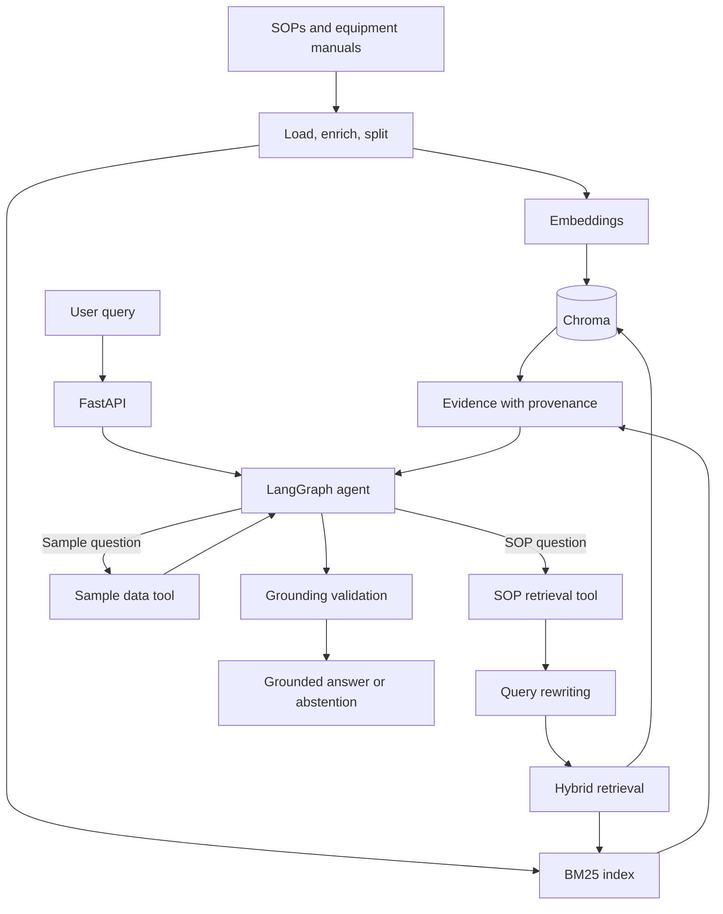

# Agentic LIMS SOP Assistant

An agentic RAG assistant for laboratory SOPs, equipment manuals, and sample
data. It answers operational questions using approved documents and explicit
tools instead of relying on model memory.

The project focuses on AI engineering: retrieval quality, agent orchestration,
grounding, provenance, validation, and evaluation. Deployment hardening is a
separate production layer.

## What it does

- Retrieves SOP and equipment-manual evidence with hybrid search.
- Uses a LangGraph agent to decide when to retrieve documents or call a tool.
- Expands SOP queries with LangChain `MultiQueryRetriever` and optionally reranks
    retrieved passages.
- Preserves document, page, and section metadata in structured citation artifacts.
- Validates answers against tool evidence, including normalized numeric units, and
    abstains when evidence is missing.
- Provides a structured sample-data tool for operational lookups.
- Includes benchmark cases, retrieval summaries, and regression tests.

## Architecture



### Main modules

| Module | Responsibility |
| --- | --- |
| `api/` | FastAPI application and chat routes |
| `agent/` | LangGraph workflow, prompts, and validators |
| `rag/` | PDF ingestion, chunking, rewriting, retrieval, reranking |
| `tools/` | SOP evidence and sample-data tools |
| `middleware/` | Final-answer grounding validation |
| `llm/` | Provider factory for Groq, Ollama, or Anthropic |
| `eval/` | Benchmark cases, metrics, and quality thresholds |
| `data/` | Local SOPs and equipment manuals |

## RAG flow

1. PDFs are loaded and enriched with source, page, document, and section metadata.
2. Documents are split into chunks and indexed for vector and keyword retrieval.
3. The agent receives a user question and selects the appropriate tool.
4. SOP queries are expanded by `MultiQueryRetriever` and searched with Chroma plus BM25.
5. Retrieved evidence is returned to the agent with provenance metadata.
6. The answer is checked for grounding, including unsupported numeric values or units.
7. The assistant answers from evidence or abstains when the evidence is missing.

Tool messages must return structured citation artifacts containing `source_name`,
`document_id`, `title`, `section`, `pages`, and `excerpt`. The API does not parse
human-readable tool text as a citation fallback.

## Representative queries

### SOP limits

> What is the acceptable pH range for the injectable sample?

The agent retrieves the relevant specification and returns the value with its
source and section when available.

### Safety procedure

> What PPE is required before handling the hazardous reagent?

Retrieval prioritizes safety and PPE sections. The answer is limited to the
equipment supported by the SOP rather than generic model knowledge.

### Procedure parameters

> At what temperature and for how long should this assay be incubated?

The retriever finds the procedure evidence, and validation checks that reported
numbers and units are supported by the retrieved passage.

### Structured operational data

> What is the current status of sample S-1042?

The agent uses the sample-data tool instead of searching SOP documents or
guessing a status.

### Missing evidence

> What is the shelf life of a reagent not mentioned in the available documents?

The assistant abstains and says the approved documentation does not establish
the answer. In a regulated workflow, this is the expected safe behavior.

## Running locally

Requirements: Python 3.12+, `uv`, and an LLM provider. Ollama is used for local
embeddings; Groq or Anthropic can be configured for the chat model.

```bash
make install
make ingest
make dev
```

The API is then available at:

- `http://127.0.0.1:8000/docs`
- `GET /health`
- `POST /api/v1/chat/completions`

Configuration is loaded from `.env` through `pydantic-settings`. Important
settings include `LLM_PROVIDER`, `GROQ_MODEL`, `SOPS_SOURCE_DIRS`, retrieval
weights, query rewriting, and reranking.

## Validation

```bash
make test
make benchmark
make lint
make typecheck
```

The deterministic benchmark checks answer quality, groundedness, source coverage,
and retrieval hit rate over the included laboratory cases. Each case also carries
retrieved evidence text for optional Ragas evaluation of faithfulness, answer
relevance, context precision, and context recall. Ragas remains an optional
evaluation dependency and is not required for the default test suite.

## Operational boundaries

The core system includes retrieval, tools, grounding, provenance, validation,
and evaluation. Deployment concerns such as authentication, access control,
metrics, alerting, secret management, scaling, and rollback remain deployment
responsibilities and should be configured for the target environment.
